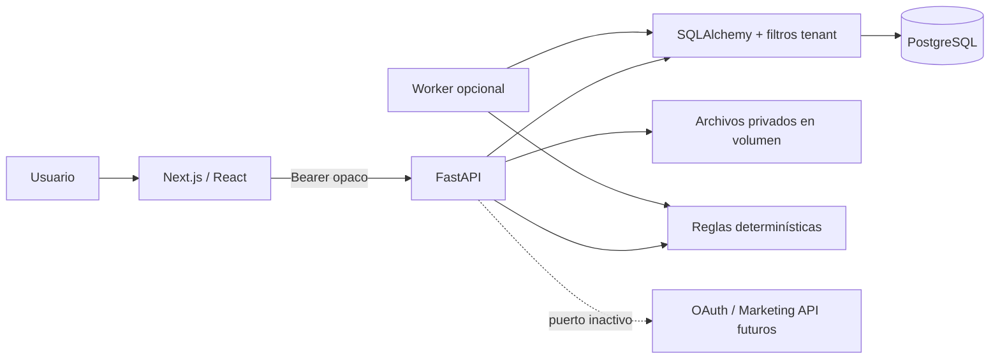

# Arquitectura

## Componentes

El navegador se comunica con la API mediante una URL pública configurable. El frontend no comparte secretos ni se comunica con Meta. FastAPI usa una única sesión SQLAlchemy por solicitud, el token resuelve al miembro y el miembro determina `tenant_id`. Los cuerpos no seleccionan empresas. El worker reutiliza la evaluación de la API; no tiene funciones de aprobación o aplicación.

## Persistencia y consistencia

PostgreSQL 17 es la base principal. SQLite permite desarrollo y pruebas rápidas; no es la referencia para concurrencia. Las migraciones Alembic son snapshots explícitos, no `create_all` al iniciar. La API aplica migraciones desde su comando Docker y luego ejecuta un seed idempotente de un solo proceso. Para escalar a varias réplicas, migraciones y seed deben convertirse en un job único de despliegue.

Las relaciones Creative→Product y Recommendation→Campaign incluyen `tenant_id` en claves foráneas compuestas. Consultas y descargas filtran por empresa. No hay RLS en esta versión: una consulta SQL privilegiada puede acceder a todas las filas. Antes de producción se requiere defensa adicional en DB.

Las operaciones de reglas, evaluación y aplicación toman un bloqueo `FOR UPDATE` sobre la fila de empresa en PostgreSQL. Eso serializa comprobaciones del presupuesto agregado dentro de la empresa. La campaña utiliza además revisión y compare-and-swap. La recomendación aplicada se devuelve sin duplicar eventos ni efectos. Los estados y el evento de auditoría se confirman en la misma transacción. Cambiar reglas invalida recomendaciones no aplicadas e incrementa revisiones de las campañas activas.

Los archivos se guardan como `UPLOAD_DIR/tenant_uuid/storage_uuid`, sin usar el nombre aportado como ruta. Una transacción fallida elimina su archivo nuevo. Una interrupción abrupta entre escritura y commit puede dejar huérfanos: hace falta recolector antes de producción. La descarga exige sesión y entrega attachment, `nosniff` y `private, no-store`.

## Flujo de decisiones

Propuesta: `pending → approved | rejected`. No se convierte en una campaña.

Recomendación: `pending → approved → applied`, o `pending → rejected`. Las actualizaciones de reglas invalidan tanto pendientes como aprobadas. `applied` representa únicamente un efecto en la base demo. No hay endpoint para un cambio manual sin revisión.

## Estrategia e IA

`strategy.py` es el proveedor `deterministic-demo`, versión `rules-v1`. La selección ABO/CBO depende de presupuesto/CPA objetivo; los anuncios se reparten de manera determinística. El margen produce un ROAS de equilibrio aproximado. No usa aprendizaje, datos de mercado ni medición causal. Un futuro proveedor LLM debe devolver un esquema validado; el motor presupuestario seguirá siendo determinístico y autoritativo.

`meta.py` define el protocolo de integración. El adaptador incluido falla explícitamente. Las rutas de conexión y publicación responden 501/403, respectivamente. Ninguna variable de entorno habilita escrituras externas. `APP_MODE` diferente de `demo` impide arrancar.

## Despliegue local

Compose: PostgreSQL + API + web; worker opcional por perfil. Puertos web y API enlazados a `127.0.0.1`. Los contenedores de aplicación no ejecutan como root. No se incluye proxy TLS porque el alcance es local. La exposición pública exige identidad real, hardening y el trabajo descrito en SECURITY.md.

## Contratos y evolución

OpenAPI vivo en `/openapi.json` y copia de entrega en `packages/shared/openapi.json`. Tipos TypeScript en `apps/web/lib/types.ts`. Regenerar el snapshot al cambiar rutas. La API incluye respuestas JSON y errores 401/403/404/409/413/422 explícitos; el frontend muestra los errores sin presentar el cambio como exitoso. Las listas del demo no implementan paginación salvo auditoría (100 eventos); es trabajo pendiente para escala.
